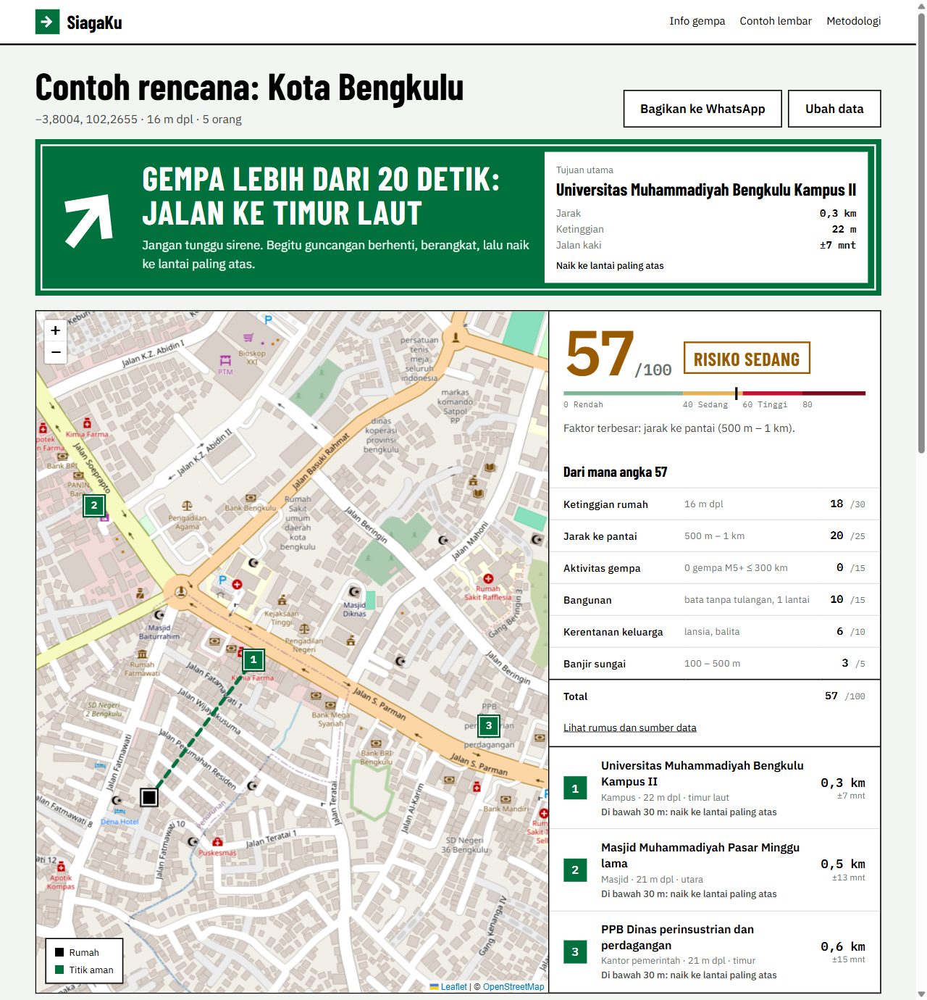

# SiagaKu

**Rencana siaga gempa & tsunami untuk satu rumah tangga — bukan untuk satu kota.**

Tandai rumahmu di peta, ceritakan siapa saja yang tinggal di sana, lalu dalam kurang dari satu menit dapatkan skor risiko yang bisa ditelusuri, titik aman terdekat, rencana evakuasi keluarga, dan isi tas siaga.

- **Website:** https://siagaku.vercel.app
- **Coba langsung tanpa isi formulir:** https://siagaku.vercel.app/hasil?contoh=bengkulu
- **Lomba:** IT RUSH 2026 — Web Development (HIMATIF UNIB), subtema **Mitigasi Bencana dan Perubahan Iklim**



---

## Masalah

Bengkulu berada di atas zona subduksi Sunda (segmen Megathrust Mentawai) dan pernah diguncang gempa besar pada 2000 dan 2007. Peta risiko dan info gempa yang ada bersifat **per wilayah**, sementara keputusan yang menentukan selamat atau tidak terjadi **per rumah**: lari ke mana, lewat mana, siapa membantu nenek atau balita, apa yang dibawa.

Kebanyakan keluarga tidak tahu ketinggian rumahnya, tidak tahu jarak pastinya ke pantai, dan tidak punya rencana tertulis.

## Fitur

| | |
|---|---|
| **Info gempa terkini BMKG** | Gempa terbaru di beranda, diperbarui tiap ±1 menit |
| **Pilih lokasi rumah** | GPS atau geser pin di peta; ketinggian (Open-Meteo) dan **jarak ke pantai dihitung otomatis** dari garis pantai OpenStreetMap |
| **Skor risiko 0–100 yang transparan** | Rumus terbuka dari 6 faktor, setiap poin ditampilkan beserta alasannya |
| **Titik aman terdekat** | Sekolah, masjid, kantor pemerintah, rumah sakit, shelter dari OpenStreetMap yang cukup tinggi; jarak, arah mata angin, dan waktu jalan kaki |
| **Papan rambu evakuasi** | Instruksi utama bergaya rambu jalur evakuasi, panah menunjuk arah titik tujuan |
| **Rencana keluarga oleh AI** | Langkah darurat, rute, peran tiap anggota, tips rumah — ditulis AI **hanya dari data yang dihitung sistem** |
| **Checklist tas siaga** | Isi dasar + kebutuhan khusus (lansia, balita, ibu hamil, disabilitas, obat rutin), tersimpan di perangkat |
| **Bagikan ke WhatsApp** | Ringkasan rencana untuk grup keluarga |
| **Tanpa akun** | Tidak ada login, tidak ada database; data hanya di perangkat pengguna |

## Cara kerja

```
Lokasi rumah ──► Open-Meteo (ketinggian)
             ──► garis pantai OSM (jarak pantai, dihitung di server)
             ──► BMKG (gempa M5+ dalam 300 km)
Data keluarga ─┐
               ▼
        Skor risiko (rumus deterministik, lib/score.ts)
               │
        Titik aman (OSM + ketinggian, aturan dua tingkat, lib/safePoints.ts)
               │
               ▼
        DeepSeek menyusun rencana dalam JSON ──► divalidasi (zod)
               │                                   │ gagal / tidak valid / titik karangan
               ▼                                   ▼
        Halaman hasil  ◄──────────────────  template cadangan (lib/rencana.ts)
```

### Prinsip AI di dalam produk

1. **AI tidak menghitung angka.** Skor dihitung rumus; AI hanya menjelaskan.
2. **AI tidak mengarang tempat.** AI hanya boleh merujuk titik aman lewat `id` dari daftar sistem. Jawaban yang menyebut titik di luar daftar **ditolak** dan diganti template.
3. **Selalu ada cadangan.** Timeout 20 detik, dicoba 2 kali; bila gagal, rencana disusun template dari data yang sama. Pengguna tidak pernah melihat layar kosong.

## Metodologi skor (ringkas)

| Faktor | Sumber | Maks | Aturan |
|---|---|---|---|
| Ketinggian rumah | Open-Meteo | 30 | < 5 m: 30 · 5–10: 25 · 10–20: 18 · 20–30: 10 · ≥ 30: 3 |
| Jarak ke pantai | garis pantai OSM (bisa diubah pengguna) | 25 | < 0,5 km: 25 · 0,5–1: 20 · 1–3: 13 · 3–5: 6 · > 5: 0 |
| Aktivitas gempa | BMKG, 15 gempa M5+ terakhir | 15 | dalam 300 km: 0 → 0 · 1 → 5 · 2–3 → 10 · ≥ 4 → 15 |
| Bangunan | pengguna | 15 | beton bertulang 3 · bata tanpa tulangan 10 · kayu 8 · > 2 lantai tanpa tulangan +5 |
| Kerentanan keluarga | pengguna | 10 | +3 per kategori (lansia, balita, ibu hamil, disabilitas), +1 tanpa kendaraan |
| Banjir sungai | pengguna | 5 | < 100 m: 5 · 100–500 m: 3 · lebih jauh: 0 |

Kategori: 0–39 Rendah · 40–59 Sedang · 60–79 Tinggi · 80–100 Sangat tinggi. Detail di halaman [/tentang](https://siagaku.vercel.app/tentang).

**Titik aman dua tingkat.** Saat membangun, kami menemukan Kota Bengkulu adalah dataran rendah: dalam 5 km dari titik contoh, tempat umum tertinggi hanya 24 m, sedangkan tempat ≥ 30 m baru ada di jarak 7–10 km — terlalu jauh dijalani sebelum tsunami tiba. Karena itu:
1. **Tempat tinggi** — ≥ 30 m (atau ≥ rumah + 15 m) dalam 5 km, diutamakan.
2. **Cadangan evakuasi vertikal** — bila tempat tinggi kurang dari 3: dalam 3 km, minimal 5 m lebih tinggi dari rumah, dan lebih jauh dari pantai; ditandai *"naik ke lantai paling atas"*.

> Skor bersifat indikatif berdasarkan faktor yang lazim dipakai BNPB/InaRISK, **bukan pengganti kajian resmi BPBD**.

## Tech stack

| Lapisan | Pilihan |
|---|---|
| Framework | Next.js 16 (App Router, Turbopack) + React 19 + TypeScript |
| Tampilan | Tailwind CSS 4, font Barlow Condensed + IBM Plex Sans/Mono/Serif (Google Fonts via `next/font`) |
| Peta | Leaflet 1.9 + react-leaflet 5, tile OpenStreetMap |
| Validasi | zod 4 |
| AI dalam produk | DeepSeek `deepseek-chat` (API format OpenAI), dipanggil hanya dari server |
| Uji | Vitest (110 unit test) |
| Hosting | Vercel |

## Menjalankan di komputer sendiri

Butuh Node.js 20 ke atas.

```bash
git clone https://github.com/Akheshi/SiagaKu.git
cd SiagaKu
npm install
cp .env.example .env.local   # isi DEEPSEEK_API_KEY (opsional — tanpa key, rencana memakai template)
npm run dev                   # http://localhost:3000
```

Perintah lain:

```bash
npm test          # unit test (skor, geo, garis pantai, titik aman, rencana, validasi)
npm run lint
npm run build
node scripts/fetch-coastline.mjs   # unduh ulang garis pantai Bengkulu
node scripts/fetch-places.mjs      # unduh ulang calon titik aman Bengkulu (+ ketinggian)
```

## Struktur folder

```
src/
  app/
    page.tsx              beranda + panel gempa BMKG
    cek/                  wizard: lokasi → rumah & keluarga
    hasil/                halaman hasil
    tentang/              metodologi & sumber data
    api/                  gempa, elevasi, pantai, titik-aman, rencana
  components/             header, footer, panel gempa, peta, kontrol form
  lib/
    score.ts              rumus skor (fungsi murni)
    geo.ts                jarak, arah mata angin, waktu jalan kaki
    coast.ts              jarak ke garis pantai
    safePoints.ts         seleksi titik aman dua tingkat
    rencana.ts            skema rencana, template cadangan, tas siaga
    bmkg.ts, input.ts     parser BMKG, skema input
    server/               pengambil data eksternal, AI, batas laju
    __tests__/            unit test
  data/                   garis pantai & calon titik aman Bengkulu (OSM)
scripts/                  pengunduh data
```

## Batasan & pengembangan lanjutan

- Ketinggian dari model elevasi global (resolusi ±90 m), bukan survei lapangan.
- Data titik aman bawaan baru mencakup Provinsi Bengkulu; daerah lain bergantung pada Overpass yang kadang lambat.
- Belum mempertimbangkan apakah bangunan tujuan benar-benar bisa dimasuki saat darurat atau berapa lantainya.
- Rute masih garis lurus + estimasi; belum memakai jaringan jalan.
- Lanjutan: data TES (tempat evakuasi sementara) resmi dari BPBD, rute jalan kaki nyata, mode luring (PWA), dan versi untuk sekolah.

## Pengungkapan penggunaan AI, library, aset, dan data

Bagian ini wajib menurut panduan lomba.

**AI coding assistant**
- **Claude Code (Anthropic)** — membantu menulis, menguji, dan merapikan kode, serta menyusun dokumen perencanaan, atas arahan dan keputusan tim. Commit yang dibantu ditandai `Co-Authored-By: Claude` di riwayat git.
- **OpenAI Codex** — asisten coding cadangan saat Claude Code mencapai batas pemakaian.

**AI di dalam produk**
- **DeepSeek** (`deepseek-chat`) — menyusun teks rencana keluarga dari data yang dihitung sistem; dibatasi dan divalidasi seperti dijelaskan di atas.

**Template**
- Proyek dibuat dari `create-next-app` (Next.js). Tidak memakai template UI siap pakai; tampilan dirancang sendiri dengan konsep "bahasa rambu evakuasi".

**Library open-source:** Next.js, React (MIT) · Tailwind CSS (MIT) · Leaflet (BSD-2-Clause) · react-leaflet (Hippocratic License 2.1) · zod (MIT) · Vitest (MIT) · TypeScript (Apache-2.0) · ESLint (MIT).

**Font:** Barlow Condensed, IBM Plex Sans, IBM Plex Mono, IBM Plex Serif — SIL Open Font License, via Google Fonts.

**Data:**
- **BMKG** — data gempa terbuka (data.bmkg.go.id). Sumber: BMKG.
- **OpenStreetMap** — peta, garis pantai, dan calon titik aman. © kontributor OpenStreetMap, lisensi ODbL.
- **Open-Meteo** — API ketinggian, lisensi CC BY 4.0.

## Tim

**Tim SiagaKu** — Universitas Bengkulu

| Nama | Peran |
|---|---|
| **Akbar Akheshi Ario Damar** — [@Akheshi](https://github.com/Akheshi) | Ketua & pengembang utama: arah produk, desain, pengembangan bersama Claude Code, deploy, pengujian |
| **Malika Afrian Nevilla** — [@Malkyyway](https://github.com/Malkyyway) | Halaman metodologi, konten, proposal & video, pengujian di perangkat |

## Lisensi

Kode: MIT. Data OpenStreetMap di `src/data/` tetap berlisensi ODbL.
